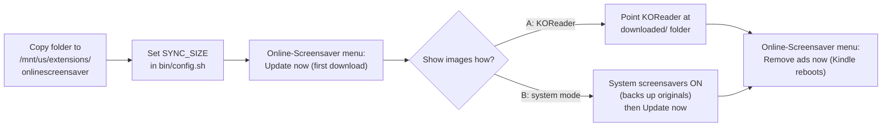
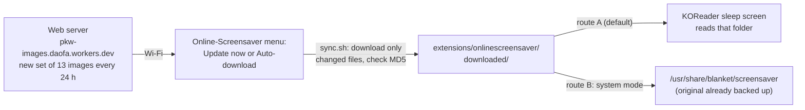

# konline_screensaver

**A fresh sleep screen on your Kindle every day, with no computer involved.**

A [KUAL](https://www.mobileread.com/forums/showthread.php?t=225030) extension for jailbroken Kindles. It downloads a daily set of screensaver images over Wi-Fi, checks every file by MD5, and keeps the set up to date.
Preview today's images: <https://pkw-images.daofa.workers.dev/sites/>

> Use at your own risk: this changes files on your Kindle. Folder sync was tested on a real Kindle; system mode only against scratch folders (see [Status](#status)). Restarting the Kindle fixes most problems, and **Restore the original screensavers** undoes system mode.

## How it works

**One-time setup** (you do this once):



**Daily usage** (automatic if Auto-download is on, or tap *Update now*):



## What you need

- A jailbroken Kindle with KUAL v2+, and Wi-Fi.
- Your screen size (images are 8-bit PNG, no colour profile):

| Kindle | Size |
|---|---|
| Basic Kindle (KT3), Kindle Touch | 600x800 |
| Paperwhite 1/2 | 758x1024 |
| Paperwhite 3/4/5, Kindle 11+ | 1072x1448 |

## Quick start

1. Download this repo (*Code > Download ZIP*), rename the folder to `onlinescreensaver`, and copy it to `/mnt/us/extensions/` on the Kindle (`menu.json` must sit directly inside).
2. Edit `bin/config.sh` (keep Unix LF line endings; use VS Code or Notepad++, not Notepad) and set your size:
   ```sh
   SYNC_SIZE="1072x1448"   # or "600x800"
   ```
3. On the Kindle: **KUAL > Online-Screensaver > Update now**. Images land in `/mnt/us/extensions/onlinescreensaver/downloaded/`.
4. Show them, with one of two routes:
   - **A. KOReader (safest):** set KOReader's sleep-screen image folder to `/mnt/us/extensions/onlinescreensaver/downloaded/`.
   - **B. Kindle's own sleep screen:** **System screensavers > ON: back up originals, then apply downloads**, then **Update now**. If old images still show, restart the Kindle. To undo: **System screensavers > Restore the original screensavers**.
5. **Block the ads (do this once, or the ads come back):** **KUAL > Online-Screensaver > Disable lock-screen ads > Remove ads now**. The Kindle reboots. If ads show up again later (for example after a firmware update), run it again.

## Automatic updates

Off by default (no background work, no battery use). **KUAL > Online-Screensaver > Auto-download**: *OFF*, *Every 24 hours* (enough, the set changes daily), or *Apply bin/auto.conf* (create `bin/auto.conf` with `AUTO_HOURS=8`, 1 to 168). The first time, a startup file is installed in `/etc/upstart` (brief `mntroot rw`). The Kindle wakes briefly each interval; it does not work if fully powered off.

## KUAL menu

| Entry | What it does |
|---|---|
| Update now | Download new images once. |
| System screensavers > ON / Restore | Back up and enable system mode / put the originals back. |
| Auto-download | OFF, every 24 hours, or custom hours. |
| Disable lock-screen ads > Remove ads now | Deletes the ad folders, sets `adunit.viewable=false`, then **reboots the Kindle**. Log: `disable_ads.log`. Based on the *Disable Ads* extension by Marek. |

## Main settings (`bin/config.sh`)

| Setting | Meaning |
|---|---|
| `SYNC_BASE_URI` | Server folder with `screensavers/<size>/meta.json` and the images. Change it if the default is unreachable. |
| `SYNC_SIZE` | `1072x1448` or `600x800`. |
| `SYNC_DELETE_EXTRA` | `1` (default) removes `bg_ss??.png` files not in `meta.json`. |
| `TEST_DOMAIN` | Host pinged to detect a connection (default `www.baidu.com`). |
| `NETWORK_TIMEOUT` | Seconds to wait for Wi-Fi. |
| `DISABLE_WIFI` | `1` turns Wi-Fi off after the run. |
| `LOGGING` | `1` logs to `/mnt/us/onlinescreensaver.log`. |
| `RTC` | Wake-up clock (0, 1 or 2; `1` for Kindle Touch). |
| `WEBHOOKADR` | Optional Home Assistant battery webhook URL. |

`TARGET_MODE` and `AUTO_HOURS` are set by the menu (`bin/target.conf`, `bin/auto.conf`); do not edit them in `config.sh`.

## Safety rules of system mode

- No write without a verified backup (kept in `backup_screensavers/`, never overwritten once complete).
- The system partition is writable only while a file really differs, then set back to read-only.
- Each file is written under a temp name, MD5-checked, then renamed.
- Free space is checked first, and downloads must still match `meta.json`.

## Status

Folder sync and system mode were tested against a local HTTP server and scratch folders with stubbed Kindle commands, and the basic download flow on a real Kindle. System mode is **not yet verified on a device**. Please report results in an issue.

## Uninstall

1. **System screensavers > Restore the original screensavers** (if used).
2. **Auto-download > OFF**.
3. Delete `/mnt/us/extensions/onlinescreensaver/`.

## Credits and license

- **peterson** ([MobileRead thread](https://www.mobileread.com/forums/showthread.php?t=236104)): original *Online Screensaver* (v0.3) and the scheduler/RTC wake-up logic.

MIT. See [LICENSE](LICENSE).
